<div align="center">


**A free, private home for your family's digital life, on a computer you own.**<br>
Files, photos, mail, calendar, notes, passwords, family chat and an AI assistant, in one app with one login.

[](https://chatpromptly.com)
[](LICENSE)
[](#install)

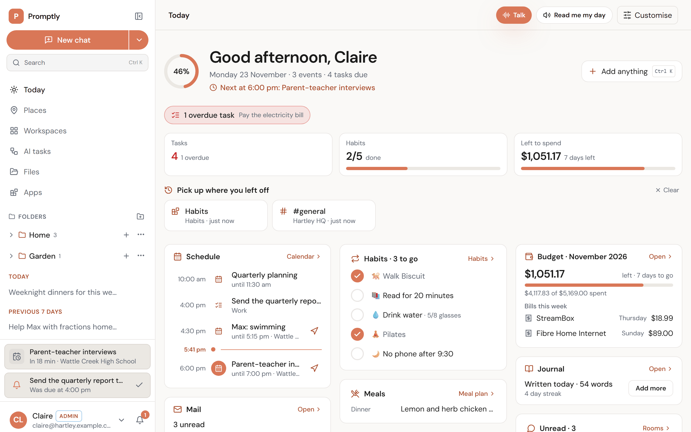

</div>

```bash
curl -fsSL https://raw.githubusercontent.com/tristenlammi/Promptly/main/install.sh | bash
```

- **Free.** MIT licence. No paid tier, no licence key, no account with us.
- **Yours.** It runs on your own machine with Docker. Your data stays on your disk.
- **Private.** No telemetry and no ads. The app never shows the server admin other people's content.
- **One login for the family.** Everyone gets their own account. You invite them; nobody can sign themselves up.
- **AI built in.** Use a hosted model with your own API key, or a local model with Ollama.

Promptly is built to replace the Google suite and the social apps a family
uses every day. The screenshots below show demo data for a made-up family.

---

## What's inside

### AI chat

Chat with the model of your choice: Anthropic, OpenAI, Google Gemini, DeepSeek,
hundreds more through OpenRouter, local models through Ollama, or any
OpenAI-compatible server. It can search the web, read pages, run research with
several agents at once and give you a cited report, remember things you tell
it, and make PDFs and images.

It also works with the rest of Promptly. Ask it to add an event, find a photo,
draft an email, start a note or read one of your files, and it will. Before it
sends something or acts for you, it asks.

<table>
<tr>
<td width="50%">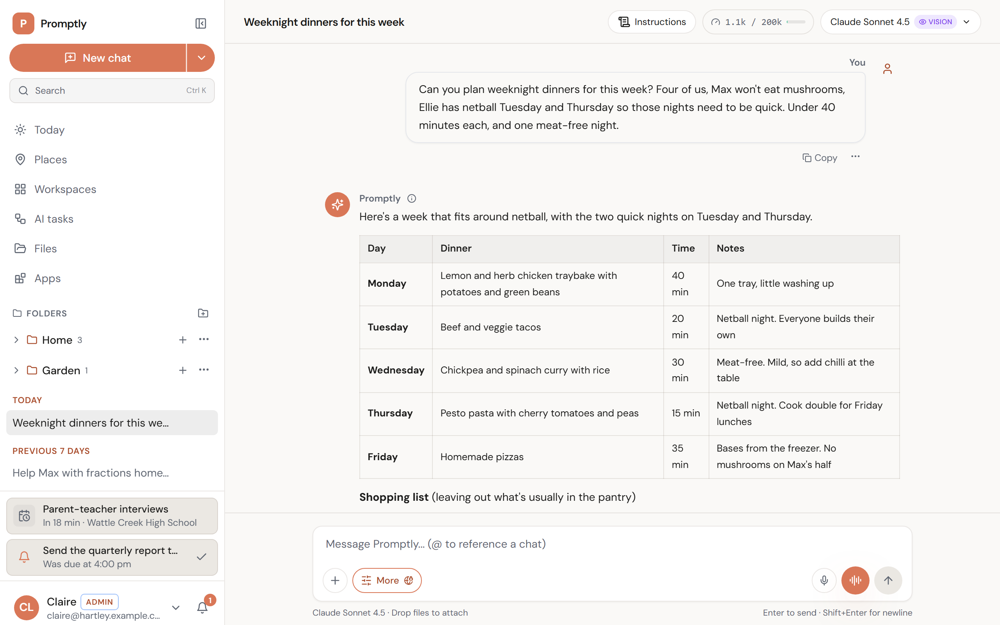</td>
<td width="50%">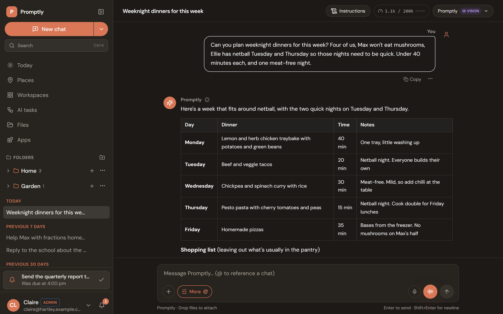</td>
</tr>
</table>

**Talk** is a spoken conversation: you talk, it answers out loud, and you can
interrupt it. Speech is turned into text and back on your own server, and
audio is never saved. **Study** turns anything you want to learn into a course
with a map, short lessons, checks and spaced reviews.

<table>
<tr>
<td width="50%">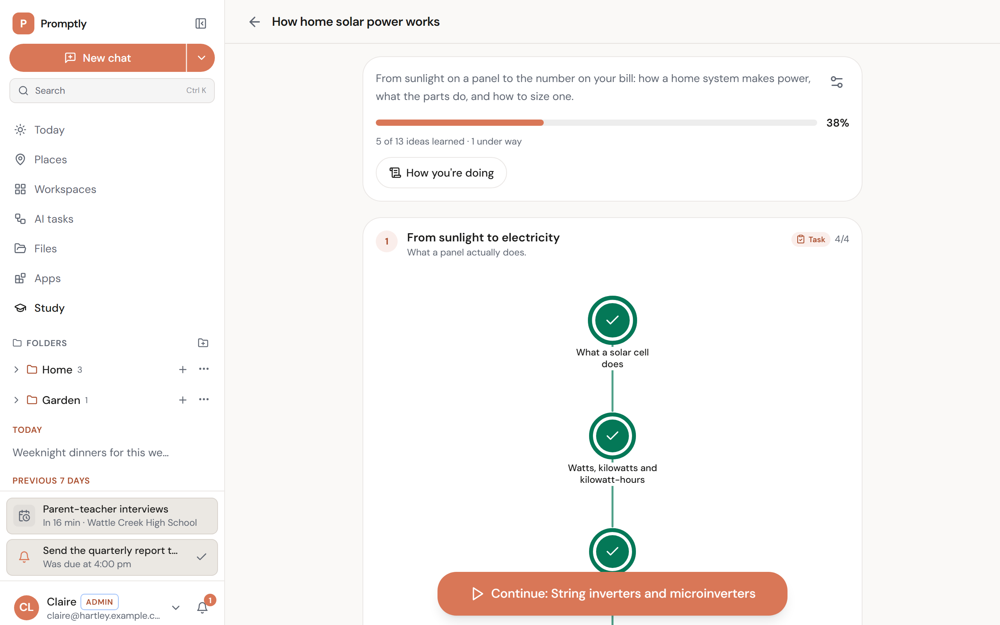</td>
<td width="50%">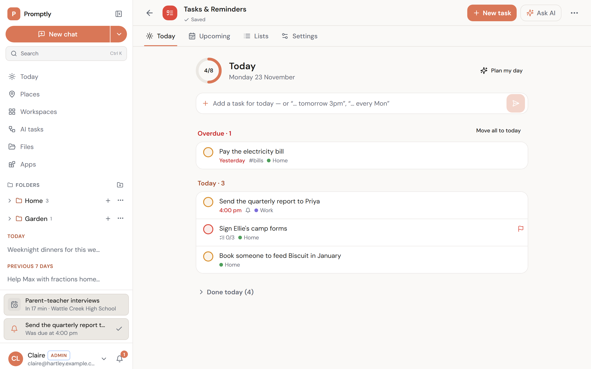</td>
</tr>
</table>

### Files and office

A drive for your files: folders, search, starred, trash, version history, and
sharing by link or with people on your server. Documents, spreadsheets and
whiteboards open in built-in editors, and several people can edit at the same
time. Documents have comments and suggestions. Presentations are built on the
whiteboard, with speaker notes and a presenter view.

- Opens and exports Word and Excel files. PDFs open in a built-in viewer.
- Big uploads resume after a dropped connection (10 GB per file by default).
- WebDAV, so the drive mounts on a computer or works with apps that speak it.

<table>
<tr>
<td width="50%">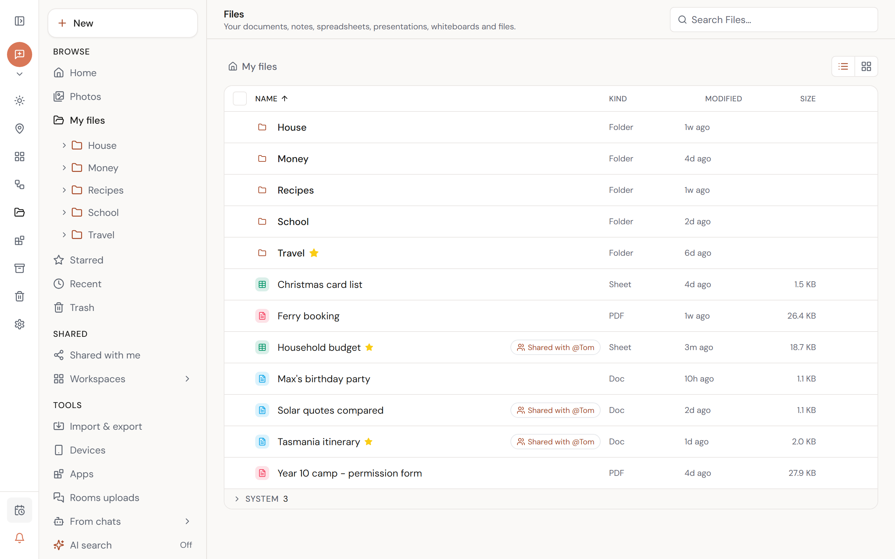</td>
<td width="50%">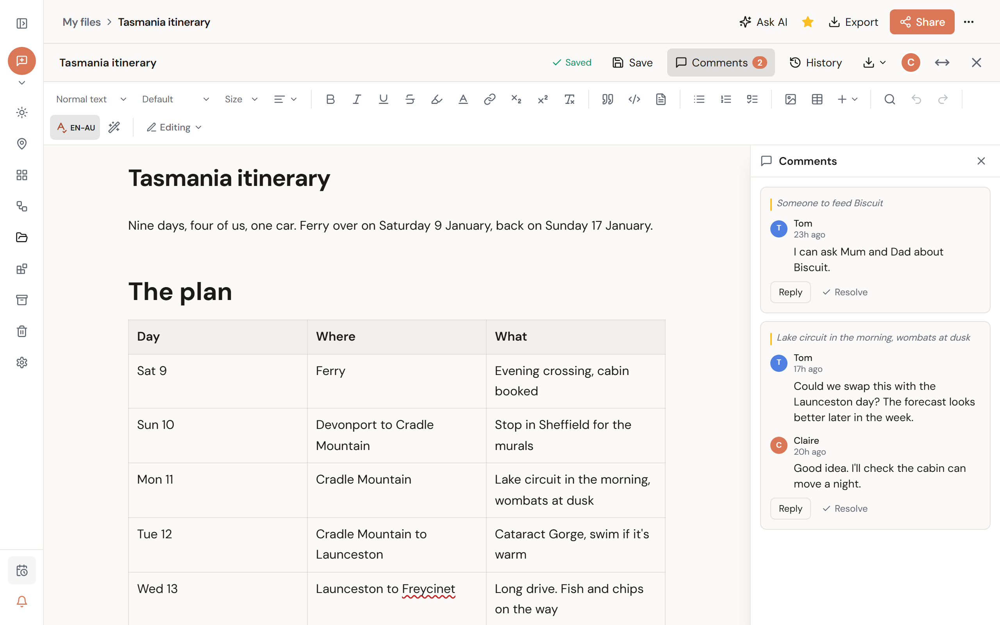</td>
</tr>
<tr>
<td width="50%">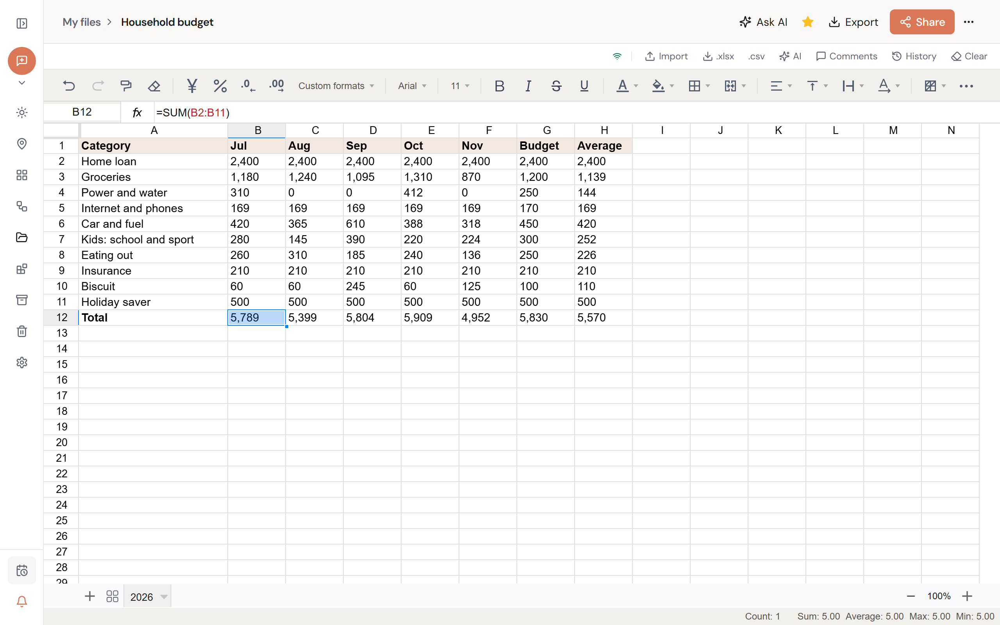</td>
<td width="50%">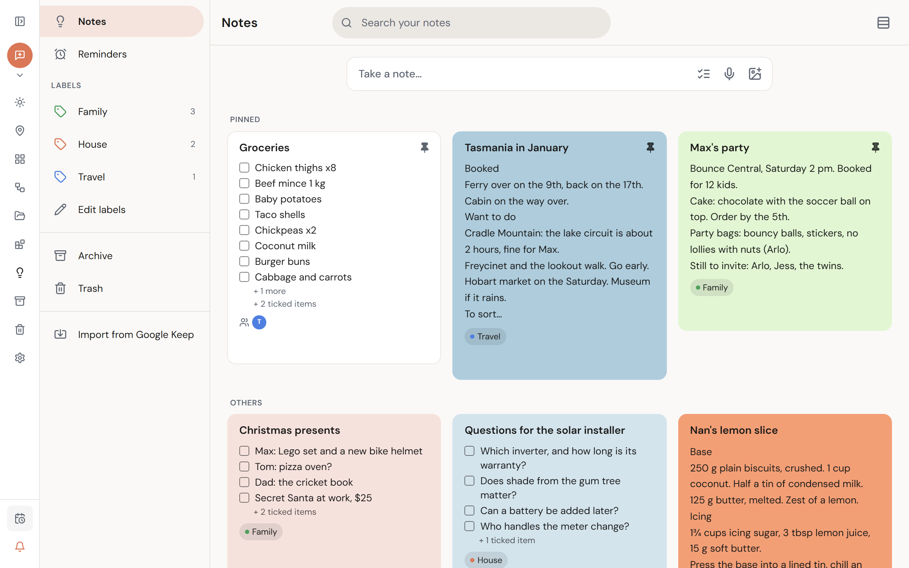</td>
</tr>
</table>

### Photos

A photo library with a timeline, albums, shared albums and public album
links, a map, places, memories, duplicate clean-up and simple editing. Search
by what's in the picture ("dog at the beach") or by text in it. Pets are
recognised; recognising people is off until each person turns it on. All of
that runs on your server. Nothing is sent to an outside service.

- The Android app backs up your phone's photos.
- Import from Google Takeout, an Apple Photos export, or a folder.
- Ask about your photos in chat.

<table>
<tr>
<td width="50%">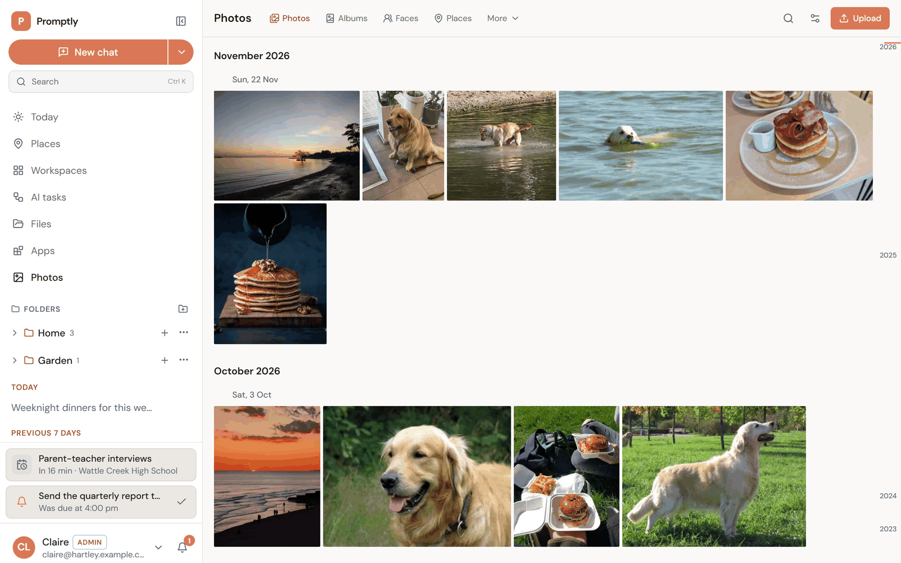</td>
<td width="50%">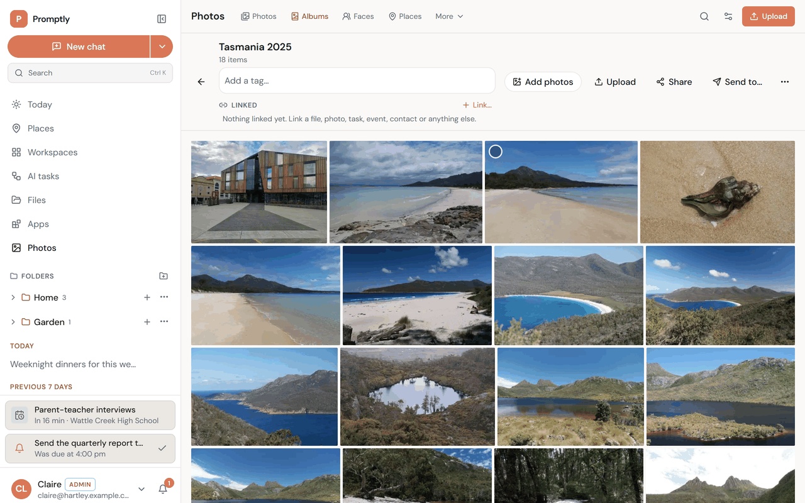</td>
</tr>
</table>

### Mail, calendar, notes and tasks

- **Mail.** Add the mailboxes you already have (IMAP and SMTP). Search, labels and rules, and an assistant that answers questions about your mail. Promptly is a mail app, not a mail server.
- **Calendar.** Your own calendar plus shared ones for the family. Invite people, get reminders, and subscribe from other calendar apps with a private link.
- **Notes.** Quick notes and checklists with colours, labels, reminders and voice notes. Share a note with someone and you both see changes. Imports from Google Keep.
- **Tasks & Reminders.** Lists, due dates, repeating tasks and alerts.
- **Today.** One page for the day: what's on, what's due, mail, meals, habits and more.

<table>
<tr>
<td width="50%">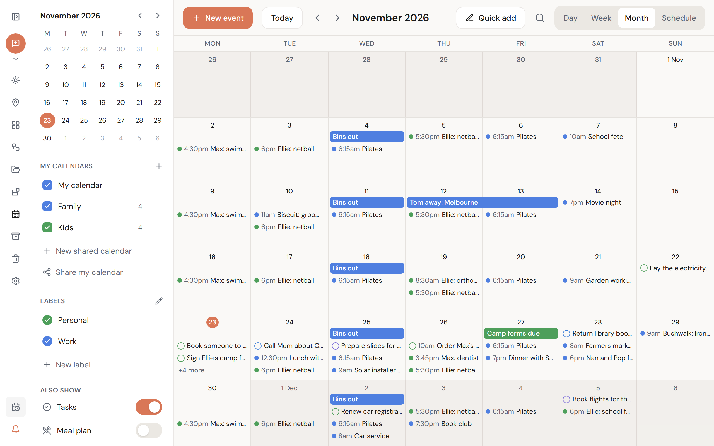</td>
<td width="50%">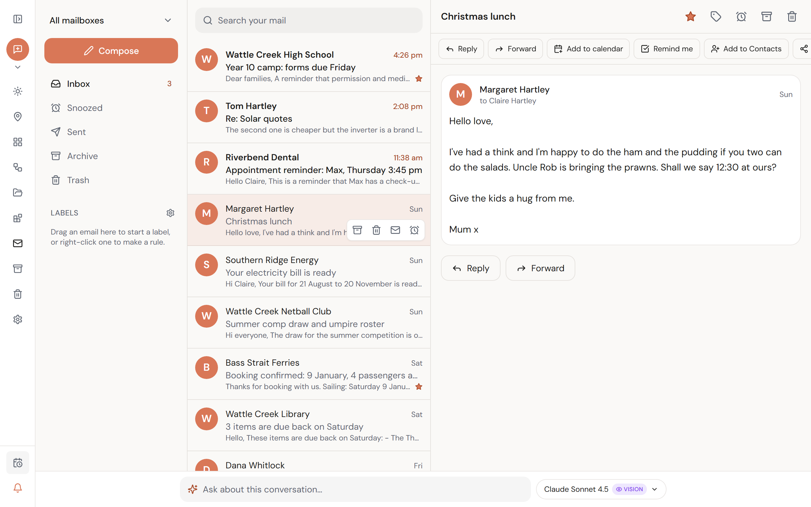</td>
</tr>
</table>

### Family and friends

- **Rooms.** Group chat in the style of Discord: spaces with rooms, direct messages, reactions, polls, files and voice messages. Voice and video channels run on your server (an admin turns them on).
- **Porch.** A small social feed for the people on your server. Posts, photos, comments and reactions, shown newest first. No ads and no ranking.

AI never reads Rooms or Porch. The one exception is a message where you type
`@promptly` to ask it something, and then it sees only that message.

<table>
<tr>
<td width="50%">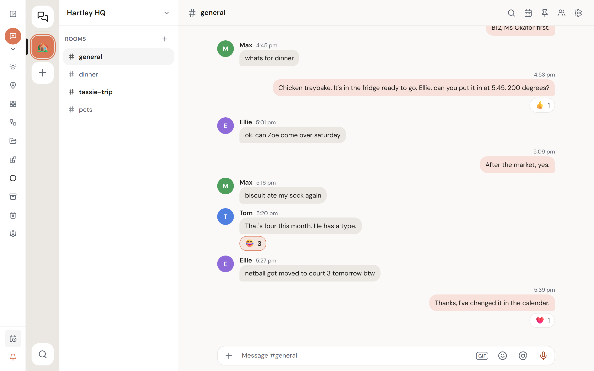</td>
<td width="50%">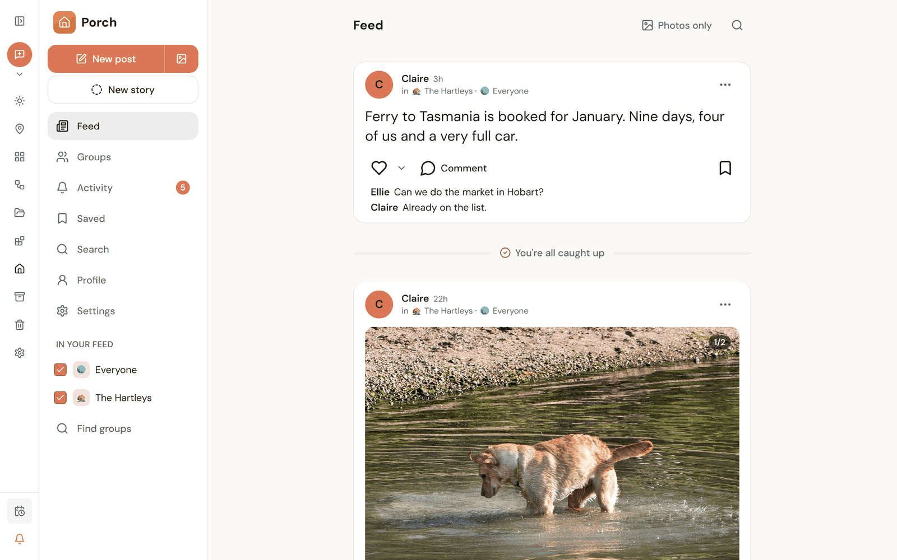</td>
</tr>
</table>

### Passwords

A password manager for the family. It is end-to-end encrypted: your vault is
locked on your device before it reaches the server, so neither the server nor
its admin can read it. Passkeys, shared vaults, one-time codes, a breach
check, and import from Bitwarden, 1Password, LastPass, KeePass, Chrome and
others.

It fills in passwords through a browser extension (Chrome, Edge and Firefox)
and in the Android app. Passwords is a preview: it has not had an independent
security audit, and the extension is installed by hand from your own server
because it isn't in the browser stores yet.

<table>
<tr>
<td width="50%">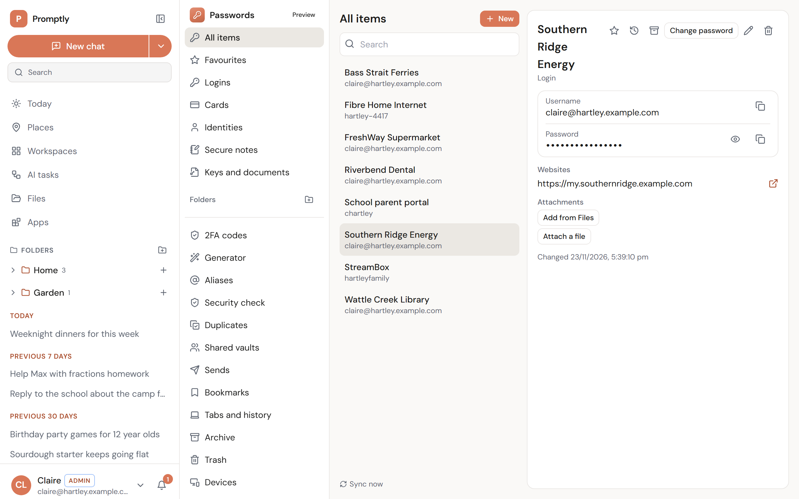</td>
<td width="50%">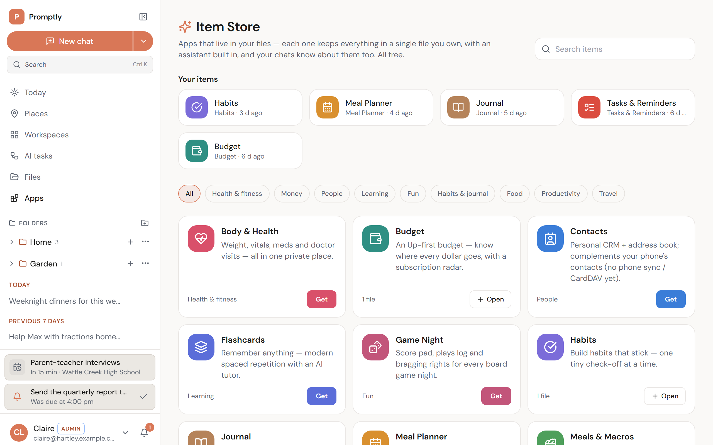</td>
</tr>
</table>

### Maps

**P Maps** is a map that runs on your server: search, directions and
turn-by-turn driving, with Android Auto and offline areas in the Android app.
Map data comes from OpenStreetMap and is stored on your disk, so searches and
routes don't go to a mapping company.

A new server has no map data. The admin chooses a country (or several) in
first-time setup or later under Admin → App settings → "Maps on this server",
and the download size, disk space and time are shown before anything
downloads. Live traffic is optional and needs your own TomTom key.

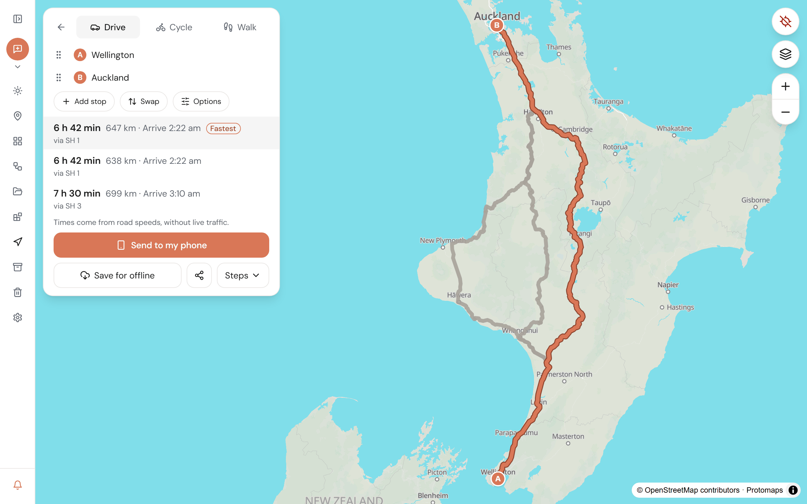

### More apps

- **Small apps** you add from the built-in store, each with an assistant: Budget, Meal Planner, Habits, Journal, Body & Health, Meals & Macros, Workout, Trip Planner, Contacts, Flashcards and Game Night.
- **Forms.** Build a form or quiz, share a link, collect answers.
- **Workspaces.** A shared space for a project: notes, boards, sheets, whiteboards and chats that know about each other.
- **AI tasks.** Things the assistant does on a schedule or when something happens, such as a morning summary. There is a visual flow editor for bigger jobs.
- **Promptly Home.** Lights, plugs, fans, scenes and speakers, through a bundled Home Assistant you never have to open. It is an add-on: install with `--with-home` (or add it later the same way), then an admin turns it on. It never unlocks doors, garages or alarms.

<table>
<tr>
<td width="50%">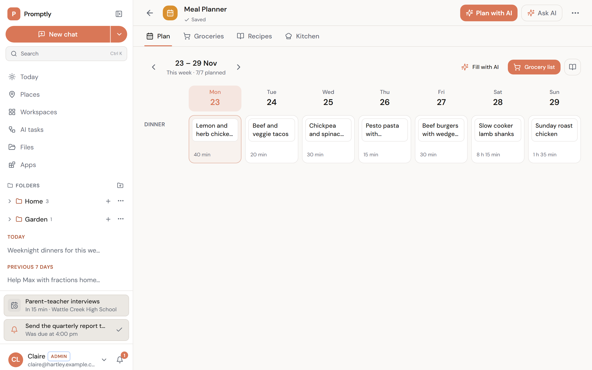</td>
<td width="50%">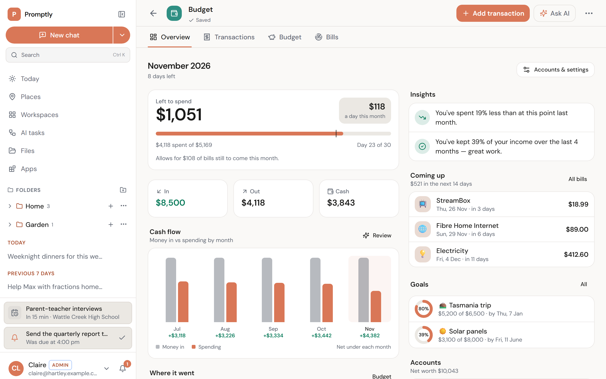</td>
</tr>
</table>

### On your phone

Promptly installs from the browser as an app on any phone or computer. There
is also an **Android app** with photo backup, home-screen widgets, password
autofill, notifications, driving with Android Auto, and a voice assistant. You
download it from your own server (the Install apps page); it isn't on the Play
Store. There is no iPhone app yet. On an iPhone, add Promptly to the Home
Screen from Safari.

<div align="center">
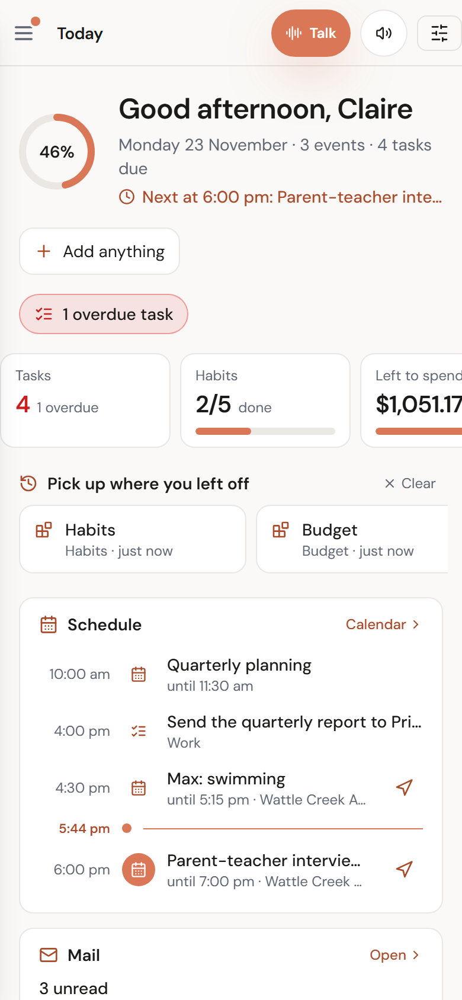&nbsp;&nbsp;
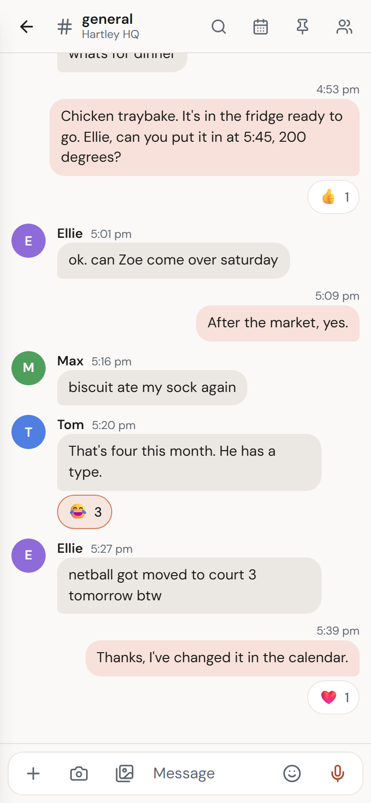&nbsp;&nbsp;
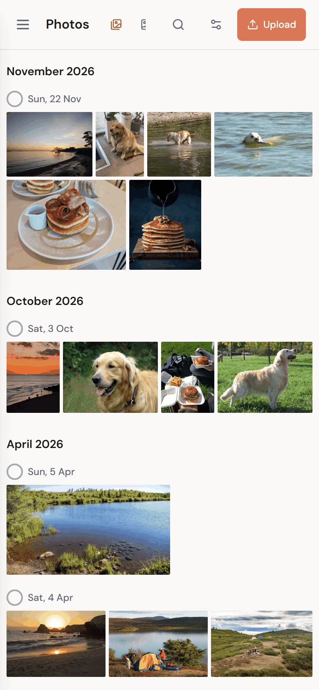
</div>

---

## What you need

| | Minimum | Recommended |
| :-- | :-- | :-- |
| **Processor** | 2 cores, 64-bit | 4 or more cores |
| **Memory** | 8 GB (on Docker Desktop, give Docker 8 GB) | 16 GB |
| **Disk** | 30 GB free | An SSD with 50 GB or more, plus room for your files and photos |
| **System** | Linux, macOS or Windows with Docker (Compose 2.24 or newer) | A Linux box that stays on: a mini PC, a NAS or a home server |

- **On the minimum**, expect a slow first build, and updates that pause photo search and speech while they build. A 4 GB machine is not enough.
- **No graphics card is needed.** Photo search and speech run on the processor.
- **Map data is extra.** For example New Zealand takes about 3 GB, Australia about 11 GB (with 18.5 GB free while it builds), Great Britain about 15 GB and Germany about 33 GB. Adding a country rebuilds the set.
- **Local AI models are extra again**: a machine with a graphics card running Ollama (see [Models](#models)).

Measured on a 4-core, 8 GB Linux test box: installing takes about 10 minutes
(longer on a slow connection) and an update 1 to 4 minutes. Sitting idle it
uses about 5.1 GB of memory, or about 4.8 GB with every optional part switched
off. It takes about 19 GB of disk before any map data (about 17 GB without
Maps); 5 to 7 GB of that is build cache that `docker builder prune` gives
back. Promptly Home, if you add it, takes about 7 GB more disk and 0.6 GB more
memory.

## Install

You need git and Docker with Compose 2.24 or newer (and curl for the one-line
install). On Linux, your user must be allowed to use Docker.

On Linux or macOS:

```bash
curl -fsSL https://raw.githubusercontent.com/tristenlammi/Promptly/main/install.sh | bash
```

On Windows, in PowerShell, with Docker Desktop running:

```powershell
irm https://raw.githubusercontent.com/tristenlammi/Promptly/main/install.ps1 | iex
```

It downloads the latest release into a `Promptly` folder where you run it and
installs from there. To add parts or leave some out, put options after
`bash -s --`:

```bash
curl -fsSL https://raw.githubusercontent.com/tristenlammi/Promptly/main/install.sh | bash -s -- --with-home --no-maps
```

The options are `--with-ollama`, `--with-home`, `--no-search`, `--no-maps`,
`--no-calls` and `--no-start` (in PowerShell: `-WithOllama`, `-WithHome`,
`-NoSearch`, `-NoMaps`, `-NoCalls`, `-NoStart`). What each one does is in
[install options](docs/guide-install-options.md).

Or clone it first and run the installer from the folder:

```bash
git clone https://github.com/tristenlammi/Promptly.git
cd Promptly
./install.sh          # Windows: .\install.ps1
```

The installer creates the secrets, builds and starts everything, and waits
until it is healthy. Then open **http://localhost:8087**. A short setup wizard
creates your admin account. From there you can set everything up now (about
ten minutes: an AI service and its models, your country's map, reaching it
from outside, email and two-step sign-in) or just look around and finish later
from the "Finish setting up" list on Today and under Admin → Setup. After
that, add your family under Admin → Users.

**Updating**

```bash
./update.sh          # Windows: .\update.ps1
```

It backs up the database first, updates, and checks everything came back.
`./update.sh --rollback` undoes it.

**Backups**

- The database is backed up every night and before every update.
- Turn on off-site backup in Admin → Backups to send an encrypted copy of everything to another disk, a NAS or a cloud bucket.
- `./scripts/backup.sh` makes one archive of everything, and `./scripts/restore.sh` puts it back.

More in [Updating, backups and storage health](docs/guide-backups.md).

## Models

Promptly doesn't come with an AI model. You connect one:

- **A hosted model**, with your own API key from Anthropic, OpenAI, Google, DeepSeek or OpenRouter. This is the easy way and needs no special hardware. You pay the provider for what you use.
- **A local model**, through [Ollama](https://ollama.com) or any OpenAI-compatible server. Nothing leaves your network.

How good the AI features are depends on the model you pick. Chat, the tools it
can use, Study, Talk and questions about your photos all lean on it. A small
local model will be noticeably weaker than a top hosted one, and running a
capable local model needs a strong graphics card.

The built-in assistant is a model called **Promptly**. The admin chooses the
model behind it, in setup or later under Admin → Models, and everyone picks
"Promptly" in chat without having to know which one that is.

Everything that isn't AI works with no model at all: files, photos, mail,
calendar, notes, passwords, Rooms and Porch.

## Reaching it from outside your home

At home, open it by the server's address on port 8087. To use it when you're
out, put it behind a tunnel (Cloudflare Tunnel is the usual choice) or a
reverse proxy with HTTPS. **Never forward port 8087 on your router.**

Phones need the HTTPS address for the microphone, the camera and
notifications to work. The full guide, with the checks to run afterwards, is
in [Reaching Promptly from outside](docs/guide-remote-access.md).

## Privacy

There is no telemetry, no analytics and no ads. Promptly doesn't report to us
or anyone else.

**What the server admin can and can't see.** The app carries the same
statement (it isn't linked from the menus; open
`/account/privacy#privacy-statement`):

> In Promptly, your admin manages accounts, storage and the server. The app
> never shows them your chats, mail, files, photos, notes, tasks, calendar,
> health, location, messages or voice. They see your account, sign-ins, how
> much space and AI you use, and errors without their contents. They see
> shared things only if they're in them, like anyone else.
>
> Two honest limits: anyone who runs the machine itself (shell or database
> access) can read what isn't end-to-end encrypted. Only Passwords is. And AI
> features send what you ask to the AI services your admin set up. Each model
> shows whether it's local or hosted.
>
> If your admin resets your password or changes your email, you'll be told,
> and it shows under Recent activity.

If you run a server for other people, that's the promise you're making. The
app keeps it: admin screens show counts and account details, never content,
and logs carry route templates, not addresses or anything typed. Docker's own
stdout logs on the host may still hold raw request lines from before v0.34.0.

**What leaves your server.** Only what a feature needs:

- What you ask the AI goes to the model provider you chose. With a local model, nothing does.
- Web searches go out to search engines through the bundled search service, without your account attached.
- One-off downloads: speech and photo-search models on first start, and map data when you set up Maps.
- Phone notifications travel through the phone maker's push service (Google's on Android, Apple's on iPhone), encrypted so only your device can read them.
- Small look-ups, such as the weather on Today (an admin can switch it off) and the password breach check, which sends only part of a scrambled password, never the password.

## FAQ

**Which AI models can I use?**
Anthropic, OpenAI, Google Gemini, DeepSeek, anything on OpenRouter, local models through Ollama, and any OpenAI-compatible server. An admin chooses which ones people see.

**Does it need a graphics card?**
No. Promptly itself runs on the processor. You only need one to run AI models locally.

**Can I bring my things over from Google?**
Yes: photos and Drive files from a Google Takeout export, and notes from Google Keep. Mail connects to your existing mailbox, including Gmail with an app password. Chats can be imported from ChatGPT and Claude exports.

**Is there an iPhone app?**
Not yet. On an iPhone, open Promptly in Safari and add it to the Home Screen. There is an Android app.

**Does it work with my phone's calendar and contacts?**
Partly. Other calendar apps can subscribe to your Promptly calendar (read-only). There is no CalDAV or CardDAV sync yet.

**How do I back it up?**
It backs up its database every night by itself. For a copy that survives the machine, turn on off-site backup in Admin → Backups. See [the backup guide](docs/guide-backups.md).

**Can other people join my server?**
Only if you invite them. There is no public sign-up. You can require two-step sign-in, and connect single sign-on (OIDC) if you use it.

**Is it finished?**
It is under active development and used daily, but it is young. Keep backups, and read the [changelog](CHANGELOG.md) before you update.

## Guides

- [Install options and local models](docs/guide-install-options.md)
- [Reaching Promptly from outside](docs/guide-remote-access.md)
- [Updating, backups and storage health](docs/guide-backups.md)
- [Photos, videos and big uploads](docs/guide-media.md)
- [Talk: setting up and tuning spoken conversation](docs/guide-talk.md)
- [How it's built](OVERVIEW.md)

See it in action at **[chatpromptly.com](https://chatpromptly.com)**.

## License

[MIT](LICENSE)
